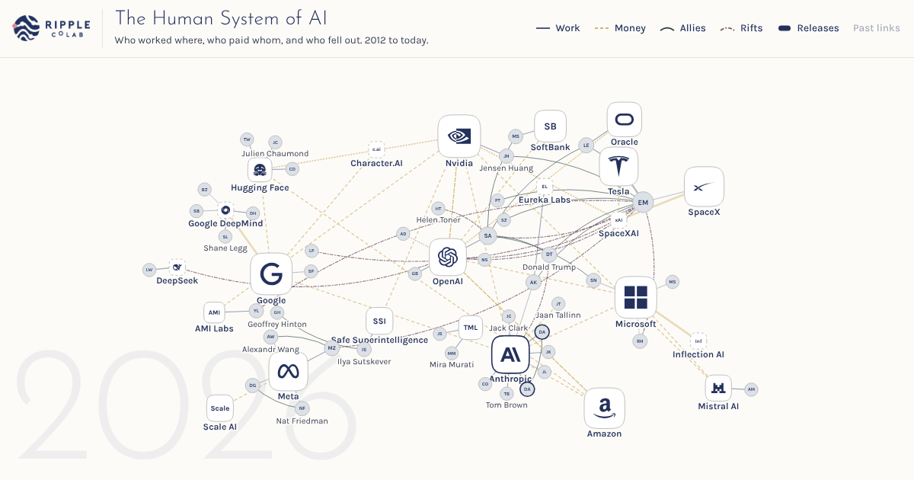

# The Human System of AI

An animated, clickable map of AI's people and organisations. It shows who worked where, who paid whom, who allied with whom and who fell out. Every item links to a public source. You can see it at https://lab.ripplecolab.com/human-system-ai/



Please credit it as: "The Human System of AI, Ripple CoLab (https://lab.ripplecolab.com/human-system-ai/)".

## The data
All in `src/ai-map/`, as JSON. Every item has a `src` field with its public source.
- `data.json`: `people`, `orgs`, `links` (ties, with `from` and `to` dates) and `events`
    - dates are `YYYY`, `YYYY-MM` or `YYYY-MM-DD`
    - `"to": null` means the tie still holds
- `releases.json`: model and product releases, by organisation
- `values.json`: values by organisation, each point with a date, a US dollar figure and its basis

## Corrections
If something is wrong or missing, open an issue that names the item and gives a source. See CONTRIBUTING.md for detail, or email mark@ripplecolab.com.

## Run it locally
Needs Python 3 and nothing else.

```
python3 src/ai-map/build.py --site public
python3 -m http.server -d public 8000
```

Then open http://localhost:8000/human-system-ai/. `fetch_faces.py` refreshes the photos from Wikimedia Commons and also needs Pillow.

## Licences
- Code: MIT (`LICENSE`)
- Data: CC BY 4.0 (`LICENSE-DATA.md`)
- Photos, fonts, logos and D3: see `CREDITS.md`
